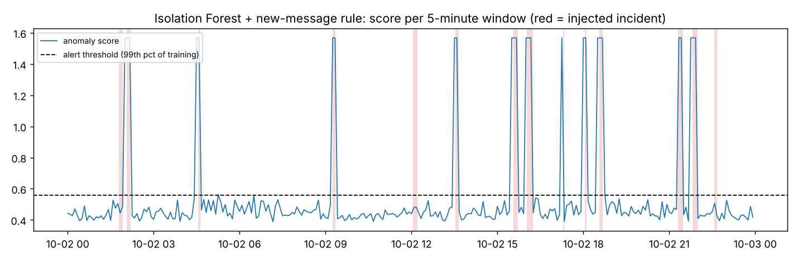

# Log Anomaly Detection

Detect incidents in application logs without labelled training data. The pipeline parses raw log
lines into message templates, turns each 5-minute window into a feature vector, and compares three
unsupervised detectors (Isolation Forest, Local Outlier Factor, One-Class SVM) plus a simple hybrid.



## Why

Production systems write thousands of log lines per minute. Most incidents show up in the logs
before anyone reports them: a burst of database timeouts, a rise in gateway errors, a message type
nobody has seen before, or requests that are suddenly slower. Labels for these incidents rarely
exist, so the detector has to learn what "normal" looks like and flag what is different.

## How it works

1. **Data**: `generate.py` writes 48 hours of realistic logs for a small payment service (API,
   gateway, database, auth, scheduler) with a daily traffic cycle. In the second day it injects 14
   incidents of five kinds: database timeouts, gateway errors, a login attack, worker crashes and a
   latency drift. Their times are saved as ground truth. *The data is synthetic*, because real
   production logs are private; you can run the pipeline on your own logs (see below).
2. **Parsing**: `parse.py` masks the variable parts of each message (IPs, IDs, numbers), so
   `GET /v1/payments/8812 200 took 45ms` and `GET /v1/payments/77 200 took 12ms` become the same
   template. It also extracts request latency.
3. **Features**: `features.py` builds one vector per 5-minute window: share of each known template,
   number of never-seen templates, event volume, error and warning share, and mean / p95 latency.
4. **Models**: `models.py` trains each detector on the first day only (no incidents, no labels). The
   alert threshold is the 99th percentile of the training scores, so it is fixed without looking at
   the test labels, as it would be in production.

## Results

Test day: 288 windows, 34 of them inside an incident. Seed 42:

| Model | Precision | Recall | F1 | ROC-AUC | Incidents caught | False alarms / day |
|---|---|---|---|---|---|---|
| Isolation Forest | 0.50 | 0.06 | 0.11 | 0.78 | 2 / 14 | 2 |
| Local Outlier Factor | 0.88 | 0.62 | 0.72 | 0.91 | 10 / 14 | 3 |
| One-Class SVM | 0.37 | 0.91 | 0.53 | 0.92 | 14 / 14 | 52 |
| **Isolation Forest + new-message rule** | **0.93** | **0.77** | **0.84** | **0.94** | 11 / 14 | 2 |

Averaged over 10 random seeds the picture is the same: the hybrid reaches F1 0.83 ± 0.08,
Local Outlier Factor 0.77 ± 0.09, One-Class SVM 0.50 ± 0.04 and plain Isolation Forest 0.07 ± 0.05.

What the numbers show:

- **Plain Isolation Forest misses almost everything here.** Tree-based models cannot split on a
  feature that was constant during training, and the "never-seen message" count is always zero on
  a clean training day. Crashes and new error types are therefore invisible to it.
- **A one-line rule fixes that.** Alerting whenever a message type appears that was never seen in
  training, combined with Isolation Forest for everything else, gives the best precision and F1
  with about two false alarms per day.
- **One-Class SVM catches every incident but raises ~50 false alarms per day**, which would be
  ignored by an on-call team. The threshold matters as much as the model.
- **Latency drifts are the hardest case**: requests get slower but no new messages appear. Most of
  the misses in the chart above are these.

## Run it

```bash
python -m venv .venv && source .venv/bin/activate      # Windows: .venv\Scripts\activate
pip install -r requirements.txt
python -m loganomaly.run                                # writes results/metrics.csv and results/scores.png
python -m loganomaly.run --seed 7 --hours 72            # other data
pytest -q                                               # 12 tests
```

Your own logs: lines in the form `2026-10-01T12:00:00.000Z LEVEL service message`, plus a CSV of
known incidents (`start,end,kind,intensity`) for evaluation:

```bash
python -m loganomaly.run --log my.log --labels my_incidents.csv --clean-hours 24
```

## Project layout

```
loganomaly/
  generate.py   synthetic logs with labelled incidents
  parse.py      log line parsing and template extraction
  features.py   5-minute window features and labels
  models.py     detectors, thresholds, metrics, hybrid rule
  run.py        command-line entry point
tests/          unit and end-to-end tests (run in GitHub Actions)
```

## Ideas for next steps

- Add a sequence model (e.g. an LSTM on template sequences, as in DeepLog) and compare.
- Use a proper template miner such as Drain3 for real-world logs with free-form messages.
- Add per-service latency features to catch drifts earlier.

## License

MIT
